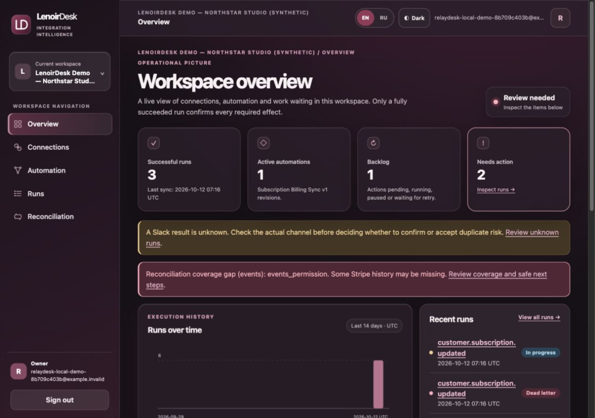
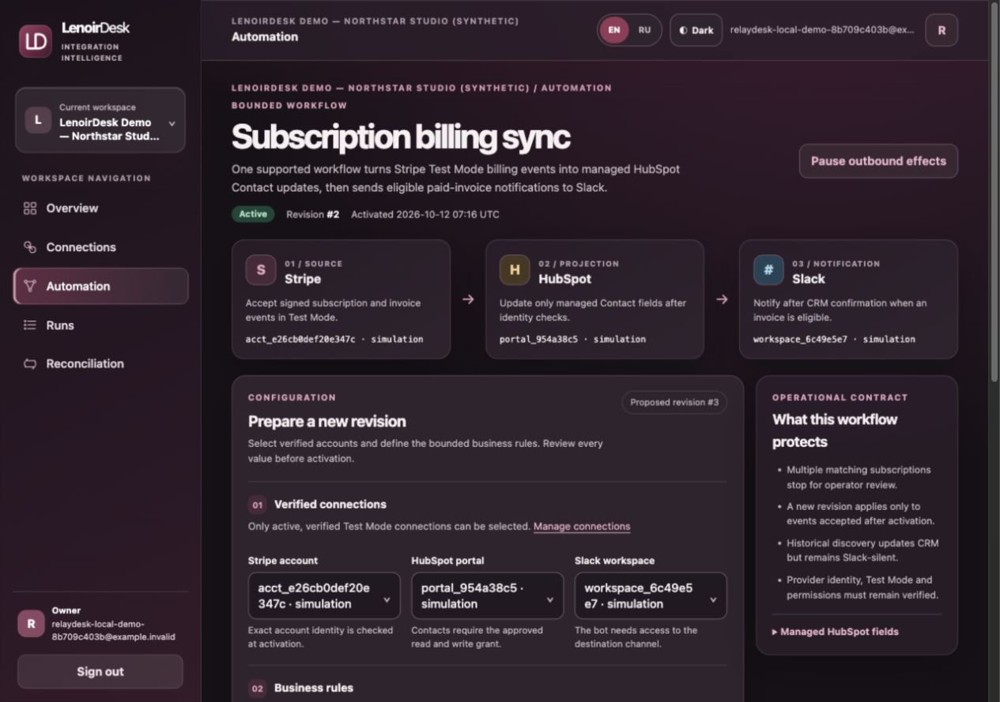
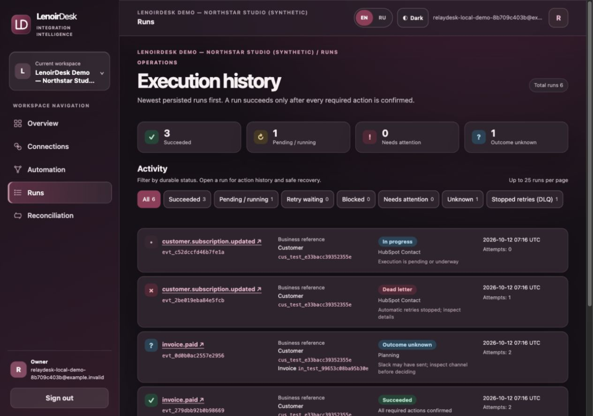
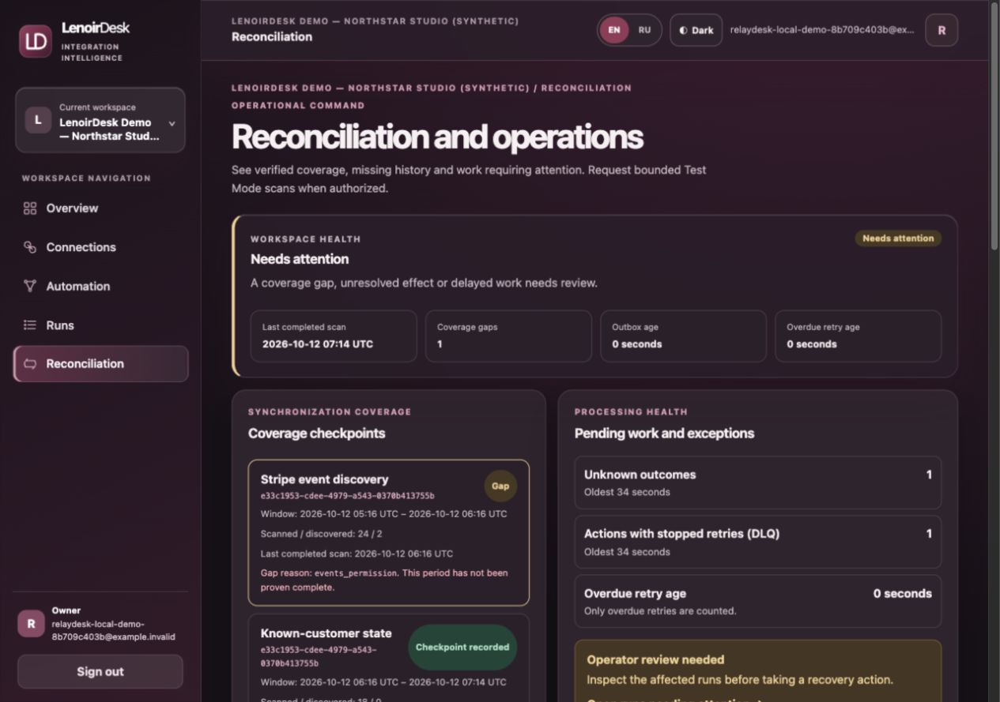
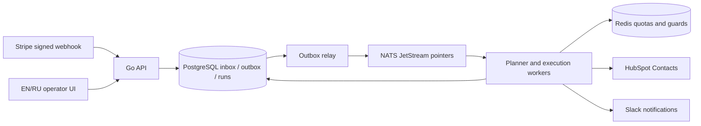

# LenoirDesk

**Billing events are only useful when the resulting business state is correct.** LenoirDesk is a multi-tenant billing integration and operations platform connecting Stripe, HubSpot and Slack. It accepts signed Stripe events, converges a HubSpot Contact against current billing state, and sends eligible Slack notifications while exposing each step to an operator. Internal database, metric and environment identifiers retain the original `relaydesk` name for compatibility.

A webhook forwarder can lose work during an outage, replay a payment twice, or report success after an uncertain provider response. LenoirDesk uses a transactional inbox and outbox, durable runs and actions, explicit retry states, and read/compare before CRM writes. Unknown Slack outcomes require an operator decision rather than an automatic duplicate send.

## What it demonstrates

- Signed Stripe snapshot webhook ingestion with account, mode, version and raw-body checks; idempotent durable acceptance.
- PostgreSQL-backed, tenant-scoped planning, action attempts, leases, audit records and recovery; NATS JetStream carries generation-fenced pointers.
- HubSpot Contact identity and current-state comparison, Redis-backed provider quotas and circuit breakers, bounded retries, dead-letter recovery, and historical Stripe reconciliation.
- Slack notification handling that distinguishes provider-confirmed success, an unknown send outcome, and an operator-confirmed result.
- OIDC sign-in, OAuth provider connections, session/CSRF controls and tenant authorization.
- Backup/restore safety gates, OpenTelemetry traces and operational metrics.
- Responsive EN/RU operator UI built with server-rendered templates, HTMX and a local design system.

## Interface (synthetic local data)

| Overview | Automation |
| --- | --- |
|  |  |
| Runs | Reconciliation |
|  |  |



The [architecture](docs/architecture.md) is explicitly labeled as a target where appropriate; the [reliability protocol](docs/reliability.md), [action state machine](docs/action-state-machine.md), [CRM identity ADR](docs/adr/0001-crm-identity.md) and [external-effects ADR](docs/adr/0002-external-effects.md) describe implemented choices. [Production gates](docs/production-readiness.md) state what remains unsupported.

## Local synthetic demo

Requires Go 1.27.2, Python 3, Docker Engine with Compose, and `make`. From a clean checkout:

```sh
make demo-local
```

Open the printed loopback URLs. The launcher creates disposable PostgreSQL, NATS and Redis resources, random ignored local credentials, an in-process test OIDC issuer and provider simulators. It does **not** use real Stripe, HubSpot or Slack accounts. The guided tour shows Overview, Connections, Automation, Runs, Run Details, Reconciliation, a temporary CRM outage and recovery. See the [demo guide](docs/lenoirdesk-demo-guide.md). Keep the terminal running; `make demo-down` stops its containers, and `make demo-reset` removes only the dedicated synthetic volumes.

For the ordinary development stack, `make up` creates a local ignored `.env`, builds images and runs migrations, then serves `http://localhost:58080/`. `make down` retains data. The development Compose and passwordless synthetic demo are loopback-only tools, not hosting or production configurations. No private credential file is required for ordinary local tests or the synthetic demo.

## Verification

```sh
make test              # Go package tests
make test-race         # Go race detector
make test-integration  # local PostgreSQL, NATS, Redis and provider simulators
make demo-check        # scripted synthetic operator journey
make verify            # formatting, locale, vet, lint, build, tests, sqlc,
                       # migrations, vulnerability and publication gates
```

`make verify` needs Docker, `golangci-lint` 2.14.0 and `sqlc` 1.31.1. The [GitHub Actions workflow](.github/workflows/ci.yml) runs a clean local stack and these gates without production credentials or deployment. Migrations are in [`migrations/`](migrations/) and the API contract is in [OpenAPI](docs/openapi.yaml).

**Local synthetic workload evidence, not a production SLO:** an isolated 20-tenant, 6,000-delivery workload on a two-CPU / 3.81 GiB Docker limit reached 100% CRM convergence within 60 seconds in the healthy varied-entity profile. A repeated-entity profile reached 99.29% within 60 seconds; its remaining retry tail drained in a longer observation. A hot-tenant quota/outage profile did not meet that healthy-provider target overall, while its healthy tenants progressed independently. The reproducible workload driver is [`scripts/mission081_load.py`](scripts/mission081_load.py); raw local artifacts and test-provider identifiers are not included.

## Scope and rights

LenoirDesk is **not production-ready**. Production provider onboarding is restricted, the synthetic demo is local-only, there is no hosted public demo, and no commercial customer deployment is claimed. Source visibility is for portfolio review; it does not imply an open-source license. No binaries or container images are published here.

Copyright © 2026 demo-lenoir. All rights reserved.

The LenoirDesk source code is provided for review and portfolio evaluation. No license is granted for reuse, modification, or redistribution outside applicable platform permissions and legal exceptions. Third-party components retain their respective licenses.

Bundled notices for HTMX, Vanilla Calendar Pro, Goose and the Go dependency inventory are in [`docs/licenses/`](docs/licenses/). The project's rights notice does not override those third-party licenses.
