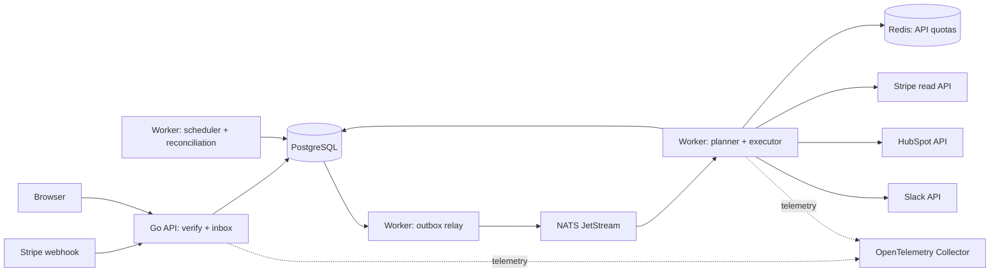

# LenoirDesk: продукт и архитектура

Документ фиксирует архитектурные границы локального MVP. Реализованные ограничения и условия production-развёртывания перечислены в [production readiness](production-readiness.md). Проверенные локальные provider-контракты, OAuth lifecycle, Redis-квоты и DLQ/replay не являются доказательством production-готовности.

## 1. Архитектурная оценка

Идея полезна, если RelayDesk продаёт уверенность в состоянии бизнес-данных: событие принято, изменение либо применено, либо имеет понятную причину задержки и путь восстановления. Само наличие трёх коннекторов — слабое отличие. Сильная сторона проекта — прозрачность исполнения, безопасные повторы и управляемое восстановление.

Первый пользователь — небольшая B2B SaaS-компания, где Stripe отвечает за подписки, HubSpot используется менеджерами, а Slack — для оперативных уведомлений. Покупатель — руководитель операций или продаж; ежедневный пользователь — менеджер и администратор интеграций.

Проверяемые гипотезы ценности:

- Компания сокращает время ручного переноса статусов и проверки оплаты.
- Менеджер видит актуальный статус и причину задержки без обращения к разработчику.
- Кратковременный сбой провайдера не требует ручной реконструкции событий.
- Ошибочная конфигурация одного клиента не останавливает остальных.

Измерять: время от подтверждённого invoice до CRM, долю действий, завершённых без вмешательства, количество дублей контактов, время устранения ошибок и время первого успешного запуска. Коммерческую готовность и спрос нужно подтвердить пилотами; это не следствие выбора стека.

Возможная модель оплаты после пилота: тариф за workspace с включённым объёмом бизнес-событий. Повторные технические попытки не тарифицируются как новая полезная работа. Собственный биллинг RelayDesk в MVP не входит.

## 2. Границы MVP

### Что входит

| Область | Решение |
| --- | --- |
| Компания | Workspace/tenant, участники, роли owner/operator/viewer |
| Stripe | Test Mode, проверка подписи webhook, чтение актуального состояния API |
| HubSpot | OAuth, связь со стандартным Contact, обновление собственных billing-полей |
| Slack | OAuth-установка бота, один выбранный канал, сообщение после успешного CRM-шага |
| Автоматизация | Один шаблон «Subscription billing sync», immutable configuration revisions |
| Надёжность | Inbox, transactional outbox, durable jobs, retries, DLQ, reconciliation |
| Панель | Подключения, настройка шаблона, история, карточка запуска, действия оператора |
| Эксплуатация | Docker Compose, CI, метрики, трассировка, runbooks, проверка восстановления |

Один Stripe account, один HubSpot portal и один Slack workspace на tenant. Для первого релиза внешний аккаунт нельзя одновременно привязать к двум tenants RelayDesk: это упрощает владение данными и квотами. Переподключение того же аккаунта сохраняет его идентичность; замена аккаунта создаёт новое подключение и не перенаправляет старые задания автоматически.

Установка нескольких провайдеров в один tenant не означает единую OAuth-сессию. Авторизация каждого провайдера независима.

### Что откладывается

Визуальный workflow builder, пользовательский код, произвольные HTTP-адреса, двусторонняя синхронизация, marketplace коннекторов, произвольные DAG, автоматические возвраты и списания, enterprise SSO/SCIM, multi-region active-active, собственный биллинг, Kubernetes и отдельный микросервис на интеграцию.

Стабильное расширение обеспечивается интерфейсами адаптеров и версионированием конфигураций. Создавать универсальный движок раньше второго существенно отличающегося сценария не нужно.

## 3. Точный бизнес-контракт

Stripe — источник истины о подписке и invoice. HubSpot — управляемая проекция выбранных полей. Slack — уведомление о бизнес-факте и результате синхронизации.

Основные входные события:

- `invoice.paid`: зафиксировать факт закрытого invoice, обновить проекцию, уведомить после CRM.
- `invoice.payment_failed`: перечитать актуальный invoice/подписку, обновить проекцию; историческое событие не должно объявлять уже оплаченный invoice неоплаченным.
- `customer.subscription.created`, `.updated`, `.deleted`: обновить текущую проекцию подписки без сообщения об успешной оплате.

Slack-уведомление в версии 1 отправляется только для `invoice.paid`. Уведомления о неуспешной оплате и отмене отложены: для них нужно отдельно определить подавление уже неактуальных предупреждений. Политика выбора revision едина: активная конфигурация на момент первого долговечного приёма события фиксируется вместе с inbox; последующая обработка не подхватывает новую конфигурацию случайно.

`subscription.created` и `checkout.session.completed` не используются как доказательство оплаты. Даже `invoice.paid` означает оплаченный/закрытый invoice, а не обязательно новое карточное списание: возможны нулевой invoice и оплата вне Stripe. Поэтому базовый текст Slack — «Invoice оплачен; CRM синхронизирована». Требование «получены деньги» потребует дополнительной проверки платёжного объекта. [Stripe: события подписок](https://docs.stripe.com/billing/subscriptions/webhooks).

Для MVP шаблон отслеживает один настроенный продукт/набор price IDs и не более одной соответствующей действующей подписки на Stripe Customer. Если найдено несколько, действие получает `needs_attention`; выбирать случайную подписку или перезаписывать статус последней пришедшей нельзя. Произвольную агрегацию нескольких подписок добавить отдельной версией шаблона.

Поля Contact:

| Поле | Смысл |
| --- | --- |
| `relaydesk_customer_key` | Уникальный стабильный ключ account + mode + customer |
| `relaydesk_subscription_id` | Выбранная отслеживаемая подписка |
| `relaydesk_subscription_status` | Статус Stripe без потери исходного значения |
| `relaydesk_payment_state` | `unknown`, `paid`, `payment_failed` по актуальному релевантному invoice |
| `relaydesk_latest_invoice_id` | Последний релевантный invoice по данным Stripe |
| `relaydesk_projection_hash` | Хеш нормализованной проекции, без временных полей |
| `relaydesk_synced_at` | Время подтверждённого изменения проекции |

Отмена и запланированная отмена различаются: `cancel_at_period_end` не превращает ещё действующую подписку в отменённую. Для этого нужен отдельный boolean в проекции. Trial остаётся trial, а не «оплачен».

RelayDesk владеет только `relaydesk_*`. Имя, телефон, owner и стандартный `lifecyclestage` менеджера не перезаписываются. HubSpot накладывает отдельные правила на обратное изменение `lifecyclestage`; billing-проекция в собственных полях исключает эту неоднозначность. [HubSpot Contacts](https://developers.hubspot.com/docs/api-reference/legacy/crm/objects/contacts/guide).

### Сопоставление клиента и контакта

1. Сначала искать сохранённое соответствие external customer → Contact ID.
2. Если его нет — получить контакт по уникальному `relaydesk_customer_key`.
3. Существующий контакт компании привязывается явно в настройке/разрешении конфликта. Email может предложить кандидата, но не является достаточным основанием для автоматического объединения людей.
4. Если соответствия нет и конфигурация разрешает создание — upsert по уникальному ключу. При конфликте email с существующим контактом — `needs_attention`, затем явная привязка оператором.
5. Удалённый или объединённый контакт вызывает проверку связи, а не бесконечное создание новых контактов.

HubSpot поддерживает upsert по custom unique property; partial upsert по email имеет ограничения. Проверить создание unique property и права на него на этапе 0. Не подменять этот механизм схемой «search → create». [HubSpot upsert](https://developers.hubspot.com/docs/api-reference/legacy/crm/objects/contacts/guide#upsert-contacts).

## 4. Пользовательский жизненный цикл

1. Owner входит через OIDC, создаёт workspace.
2. Подключает Stripe Test Mode: restricted read key и отдельный webhook signing secret. Проверяются режим, account identity и доступ к нужным read endpoints. Создание подписки происходит в Stripe Dashboard/демо-инструменте, а не через production write credentials RelayDesk.
3. Проходит HubSpot OAuth; система проверяет portal, scopes и наличие собственных полей. Schema provisioning — отдельный idempotent setup-step с предварительно показанным перечнем создаваемых полей.
4. Устанавливает Slack-бота через OAuth, выбирает доступный канал, проверяет членство бота.
5. Настраивает продукт, контакт/политику создания и включает шаблон. Сохраняется revision 1 и activation timestamp.
6. Создаёт тестовую подписку. Панель показывает входное событие, CRM-изменение, уведомление и ссылки на внешние объекты.
7. При ошибке видит причину: «повтор в 14:32», «нужно переподключить HubSpot», «требуется привязать контакт», «результат отправки неизвестен».
8. Оператор исправляет проблему и возобновляет только требуемый шаг. Применённые изменения не откатываются из-за сбоя Slack.
9. Pause прекращает новые внешние действия, но продолжает принимать события в пределах квоты; текущий HTTP-вызов может завершиться. Resume пересчитывает актуальную CRM-проекцию. Накопленные уведомления доступны к отправке по явно выбранной политике; по умолчанию не отправлять лавину исторических сообщений.
10. Disconnect блокирует новые вызовы, завершает/карантинирует in-flight задания, отзывает токены там, где API это позволяет, и удаляет локальные credentials. Переподключение снимает блокировку только после проверки того же account ID.
11. Удаление workspace сначала запрещает новую работу, затем удаляет credentials и персональные данные по политике retention. Задания с уже начатым внешним вызовом нельзя объявлять отменёнными до определения результата.

Onboarding по умолчанию запускает future-only обработку. Историческая сверка — отдельная операция с диапазоном, лимитом и предварительным счётчиком; она обновляет CRM, но не рассылает исторические Slack-уведомления.

Ручное подключение Stripe key — сознательное ограничение закрытого Test Mode MVP. Перед публичным live onboarding отдельно выбрать подходящую модель Stripe app/Connect access и проверить её допустимость для продукта; OAuth HubSpot и Slack не решает авторизацию Stripe.

## 5. Архитектура развертывания



Один Go module и один набор domain packages; два исполняемых процесса: `api` и `worker`. Worker содержит ограниченные пулы planner/executor, outbox relay, scheduler и reconciler; их можно масштабировать раздельно конфигурацией процесса без немедленного разделения кодовой базы на сервисы.

PostgreSQL — источник истины о том, что принято, что нужно выполнить и что подтверждено. JetStream — долговечная доставка небольших указателей на работу. Redis — восстанавливаемое состояние квот; потеря Redis не должна удалять задания, соответствия или ключи дедупликации.

Такое сочетание PostgreSQL и JetStream сознательно сложнее минимальной DB-only очереди. Здесь JetStream соответствует заданному стеку и позволяет отдельно управлять доставкой и worker concurrency. Чтобы не получить два планировщика, расписание бизнес-повторов принадлежит только PostgreSQL.

## 6. Модули и границы

| Модуль | Ответственность | Чего в нём нет |
| --- | --- | --- |
| `identity` | OIDC session, users, membership, RBAC | OAuth-токенов интеграций |
| `tenancy` | Tenant context, quotas, lifecycle | Доверия tenant ID из browser без membership |
| `connections` | Account binding, OAuth state, credentials, refresh/revoke | Планирования бизнес-шагов |
| `ingress` | Signature verification, inbox, payload limits | Вызовов HubSpot/Slack |
| `automation` | Typed config, immutable revisions, eligibility | Универсального DSL |
| `execution` | Run/action state machine, attempts, leases, replay | Provider-specific JSON |
| `projection` | Canonical customer/subscription model, mapping, desired state | HTTP transport |
| `connectors` | Stripe, HubSpot, Slack; перевод ошибок в общий контракт | Решений о числе бизнес-повторов |
| `delivery` | Outbox, JetStream envelope, ACK, dispatch recovery | Источника истины о выполнении |
| `reconciliation` | Проверка пропусков и расхождения состояния | Массового replay уведомлений |
| `audit` | Кто что подключил, изменил, повторил, удалил | Секретов и полных HTTP bodies |
| `platform` | DB, crypto, clock, OTel, config | Бизнес-правил |

Внутри Go: domain structs и state transitions, application services, provider/storage adapters. Интерфейсы вводятся на границах БД, clock, secret store и внешних API, а не на каждый struct. Dependency injection через конструкторы, без DI-фреймворка, глобальных clients и generic repository.

Пример будущего расположения:

```text
cmd/api/               cmd/worker/
internal/identity/    internal/tenancy/
internal/connections/ internal/ingress/
internal/automation/  internal/execution/
internal/projection/  internal/connectors/{stripe,hubspot,slack}/
internal/delivery/    internal/reconciliation/
internal/audit/       internal/platform/
migrations/           api/openapi.yaml
web/                  deploy/compose/
tests/integration/    tests/scenarios/
docs/adr/             docs/runbooks/
```

## 7. Модель данных

Все tenant-owned таблицы содержат `tenant_id NOT NULL`. Идентификаторы внешних объектов всегда рассматриваются в контексте provider account и test/live mode.

| Таблица | Основные данные / ограничения |
| --- | --- |
| `tenants`, `users`, `memberships` | Role в конкретном workspace; unique tenant/user |
| `connections` | provider, account_id, mode, status, generation, scopes, health |
| `connection_credentials` | Ciphertext, nonce, key_version, expiry, credential_version |
| `oauth_sessions` | Hash state, user, tenant, provider, expiry, consumed_at |
| `automation_revisions` | Template version, config JSON с typed validation, activation interval |
| `webhook_events` | Raw verified payload, event ID, api_version, timestamps, classification |
| `runs` | Event/reconcile trigger, revision, aggregate key, display status |
| `actions` | Stable effect key, dependency, status, due_at, lease, dispatch generation |
| `action_attempts` | Attempt number, outcome, HTTP/request IDs, safe error, timestamps |
| `outbox` | Envelope ID, subject, payload reference, publish lease, published_at |
| `entity_links` | Stripe Customer → HubSpot Contact; unique within tenant/account |
| `projections` | Desired hash, observed hash, local revision, dirty flag, sync state |
| `notification_effects` | Unique invoice fact + destination; Slack channel/ts if confirmed |
| `reconcile_checkpoints` | Pagination/cursor, interval, last complete scan, coverage gap |
| `audit_log` | Actor, operation, object, safe changes, reason, timestamp |

Ключи:

- Inbox uniqueness: `(tenant_id, provider, provider_account_id, mode, event_id)`. Переподключение не сбрасывает дедупликацию.
- Run uniqueness для event trigger: `(tenant_id, event_id, automation_revision_id)`.
- Effect uniqueness: `(tenant_id, effect_type, business_object_key, destination_identity)`. Revision конфигурации сама по себе не разрешает повторить уже отправленное уведомление.
- Tenant-scoped foreign keys: `(tenant_id, connection_id)`, `(tenant_id, run_id)` и т. п.; принадлежность нельзя нарушить даже ошибочной записью приложения.
- Индексы для истории `(tenant_id, created_at DESC, id)`, для scheduler частичный индекс `(next_attempt_at, tenant_id)` по runnable status, для outbox — по неопубликованным строкам.

Typed колонки используются для ключей/состояний/фильтров; JSONB — для версии конфигурации, payload и ограниченного диагностического контекста. История не строится по логам и не зависит от доступности NATS.

## 8. Tenant isolation и безопасность

API проверяет membership в каждом tenant-scoped запросе. UUID не заменяет авторизацию. Viewer читает историю, operator исправляет mapping и возобновляет шаги, owner управляет подключениями и участниками.

Два слоя защиты БД: обязательный tenant filter в SQL и RLS с `USING`/`WITH CHECK`. Контекст задаётся через `SET LOCAL` внутри транзакции, чтобы connection pool не переносил tenant между запросами. Runtime-роль не владелец таблиц и не имеет `BYPASSRLS`; таблицы используют `FORCE ROW LEVEL SECURITY`. В PostgreSQL superuser и BYPASSRLS обходят политики независимо от обычных фильтров. [PostgreSQL RLS](https://www.postgresql.org/docs/15/ddl-rowsecurity.html).

Глобальный scheduler не получает универсальный доступ к credentials. Отдельная служебная роль/узкие SQL-функции выдают только dispatch metadata для всех tenants. Executor начинает tenant-scoped транзакцию и заново проверяет связь задания, run и connection. Cross-tenant функции имеют фиксированный `search_path`, минимальные grants и тесты; browser API не может их вызывать.

Webhook route содержит opaque connection reference; ограниченный lookup получает account/secret. До проверки подписи это только кандидат на tenant. Подписанный payload, account binding и test/live mode должны совпасть. Произвольный `tenant_id` из payload не принимается как полномочие.

OAuth:

- Authorization code flow; одноразовый случайный state связан с user, tenant, provider, redirect и TTL.
- Membership перепроверяется на callback; повторное использование state запрещено.
- PKCE включается там, где выбранный flow провайдера его поддерживает; совместимость проверяется на этапе 0.
- Минимальные scopes. HubSpot object read/write отделены от временной потребности создать schema.
- Refresh сериализуется по connection, с lease/version compare-and-swap и атомарным сохранением новой пары токенов. `singleflight` только внутри процесса недостаточен.
- Потерянный ответ rotation может потребовать повторной авторизации; нельзя обещать восстановление одноразового refresh token без поддержки провайдера.

HubSpot требует OAuth для приложений, устанавливаемых несколькими аккаунтами. Slack имеет отдельную опцию rotation; нельзя предполагать одинаковую модель срока жизни токенов у всех провайдеров. [HubSpot OAuth](https://developers.hubspot.com/docs/apps/developer-platform/build-apps/authentication/oauth/working-with-oauth), [Slack rotation](https://docs.slack.dev/authentication/using-token-rotation/).

Credentials: authenticated encryption стандартной библиотекой/SDK, случайный nonce, associated data `tenant + connection + provider + key_version`. Сейчас локальная конфигурация использует отдельный непопадающий в Git ключ. Envelope encryption через KMS, операционная ротация и восстановление ключей остаются требованиями к будущему production-развертыванию, а не реализованными гарантиями.

Сессия панели — server-side, Secure/HttpOnly/SameSite cookie, CSRF-защита мутаций; credential не возвращается в browser. OIDC через готового провайдера, локально возможно тестовое OIDC окружение. OAuth интеграций не заменяет вход пользователя в RelayDesk.

Логи/трейсы проектируются без access/refresh tokens, Authorization, webhook secret, полного email и raw payload. В реализованных provider adapters заданы фиксированные API hosts, запрет следования редиректу с credentials, ограничения body и таймауты. Публичный TLS-терминатор и сетевой egress allowlist остаются отдельными deployment-gates, которые локальная проверка не подтверждает.

## 9. Технологические решения

| Технология | Назначение и основание |
| --- | --- |
| Go, `net/http`, chi | Явные timeouts/context, простой REST router |
| PostgreSQL, pgx, sqlc | Транзакции/constraints/RLS видны в SQL, типизированный доступ |
| Goose | Версионируемые SQL migrations; один migration job |
| NATS JetStream, nats.go | Durable pull consumers, bounded concurrency, независимый transport |
| Redis, go-redis | Атомарные API budgets/cooldowns; без хранения истины о задачах |
| stripe-go | Provider SDK и официальная проверка webhook signatures |
| HubSpot/Slack adapters | Небольшие typed HTTP clients под используемые endpoints |
| Go templates + HTMX | Небольшая операторская панель без отдельной SPA-платформы |
| OpenAPI | Контракт REST, валидация ошибок, cursor pagination |
| slog + OpenTelemetry | Структурированные логи, distributed tracing и metrics |
| Prometheus/Grafana + trace backend | Рабочие dashboards и разбор инцидентов |
| Docker Compose | Воспроизводимая разработка/демо; образ приложения non-root |

Выбор HTMX обусловлен маленькой панелью и Go-фокусом проекта. React имеет смысл, когда появится сложный интерактивный редактор. Temporal следует оценить при долгоживущих branching workflows; Kafka — при требованиях к большому event log и множеству независимых consumers. Сейчас оба добавляют эксплуатационную цену без обязательной пользы.

Версии Go, контейнеров, SDK и provider API закрепляются после compatibility spike: никакого `latest`. Нельзя автоматически брать preview API из примера документации. Проверить реально поддерживаемую связку версий Stripe event format/SDK и HubSpot API generation; изменения делать через contract fixtures и staging.

## 10. Панель и REST

Пять экранов: Overview, Connections, Automation, Runs, Run details. Отдельный список Needs attention/DLQ — фильтр истории, а не другая система.

В карточке запуска: бизнес-факт, source event ID, config revision, dependency graph из двух шагов, попытки, время следующего повтора, safe error, внешний request ID, Contact link, Slack link при подтверждении. Различать «CRM обновлена, уведомление ожидает» и полный успех.

Минимальный REST:

```text
GET  /v1/tenants/{tenant}/connections
POST /v1/tenants/{tenant}/connections/{provider}/authorize
GET  /oauth/{provider}/callback
POST /webhooks/stripe/{connection_ref}
GET  /v1/tenants/{tenant}/automations
POST /v1/tenants/{tenant}/automations/{id}/revisions
POST /v1/tenants/{tenant}/automations/{id}/pause
POST /v1/tenants/{tenant}/automations/{id}/resume
GET  /v1/tenants/{tenant}/runs?cursor=...&status=...
GET  /v1/tenants/{tenant}/runs/{run_id}
POST /v1/tenants/{tenant}/actions/{action_id}/retry
POST /v1/tenants/{tenant}/actions/{action_id}/resolve
POST /v1/tenants/{tenant}/reconciliations
```

Mutation endpoints имеют RBAC, audit и request idempotency key там, где запрос создаёт операцию. Повтор кнопки Retry не создаёт вторую независимую бизнес-операцию. Ошибки — стабильные error codes + понятный текст + correlation ID, без секретных response bodies.

## 11. Эксплуатация, стоимость и жизненный цикл релиза

Локально: Compose с API, worker, PostgreSQL, Redis, JetStream и optional observability profile. Один узел — демонстрационное окружение без заявления HA.

Пилот: staging и production разделены по secrets, provider apps и данным; автоматические backups PostgreSQL, сохранность encryption keys, ограниченные worker pools. Production HA при соответствующем бюджете — managed HA PostgreSQL и JetStream quorum на трёх независимых узлах; число реплик не заменяет backup/restore test.

SDLC: ADR → короткая ветка → PR с проверяемыми инвариантами → CI → миграция expand → совместимый rolling rollout → smoke → наблюдение → cleanup migration позже. Worker должен понимать текущую и предыдущую envelope schema. Rollback binary не отменяет внешние CRM-изменения; необратимая миграция не должна сопровождать обычный релиз.

Предлагаемые цели для пилота, пока не измеренные:

- Webhook durable acceptance p95 < 500 ms на заявленной тестовой нагрузке.
- 99% допустимых событий синхронизируют CRM за 60 секунд при доступных провайдерах и достаточных квотах; отдельно показывается полная задержка с внешними сбоями.
- Обнаружение зависших runnable jobs за 2 минуты.
- Для демо после минутного отказа HubSpot завершение в пределах 2 минут после восстановления.
- Production planning target: RPO ≤ 15 min, RTO ≤ 60 min; утверждать после restore drill и проверки бюджета. Это не обещание нулевой потери при уничтожении БД.

Начальный нагрузочный профиль: 20 tenants, 100 000 входных событий/сутки суммарно, burst 100 events/s в течение минуты, payload до 256 KiB с проверкой реальных fixtures. Это параметры теста, не доказанная пропускная способность. Для внешних вызовов важнее `events × calls per event × retries / account quota`; локальный ingress benchmark не доказывает скорость HubSpot.

Метрики: ingress failures, inbox duplicates, oldest unpublished outbox age, queue age, runnable overdue age, active leases, completion latency, retries по категории, DLQ/unknown age, refresh errors, 429, reconcile drift, storage growth. Не помещать event_id/customer_id/tenant_id в высококардинальные Prometheus labels; подробности доступны в защищённой истории/логах.

Retention baseline: raw payload 7 дней; очищенные attempts/runs 30 дней; audit 90 дней; dedup/effect keys 90 дней и дольше для объектов, доступных replay. Эти числа — продуктовая политика пилота, не правовое требование. Старый replay за пределами гарантированного окна блокируется и предлагает state reconciliation; удаление raw payload не удаляет незавершённую работу и компактные доказательства эффектов. Backup expiration согласуется с удалением tenant.

Рост контролировать по возрасту очереди и квотам провайдеров, а не только CPU. Сначала оптимизировать repeated reads/coalescing, индексы и fair scheduling; затем увеличивать workers. Отдельные базы/очереди на tenant нужны при измеренной изоляционной или регуляторной потребности.

## 12. Зафиксированные компромиссы и открытые проверки

- Это directional sync, а не distributed transaction: CRM не откатывается при ошибке Slack.
- Exactly-once для внешних эффектов не обещается; подробная политика в [протоколе надёжности](reliability.md).
- Пользовательские изменения managed-полей HubSpot могут быть перезаписаны следующей сверкой. UI явно сообщает владение этими полями.
- Отказ Redis задерживает outbound, сохраняя приём webhook, пока хватает DB capacity.
- Общая БД и общие worker pools дают логическую изоляцию, но не физическую изоляцию ресурсов.
- Требуют проверки на реальных аккаунтах: OAuth distribution/install limits, scopes, unique properties, API versions, account identity, callback domains, Slack permissions и contract errors. До этого нельзя считать интеграции реализуемыми во всех тарифах.

Открытые вопросы совместимости провайдеров перечислены выше и должны проверяться на изолированных test accounts до любого production rollout.
