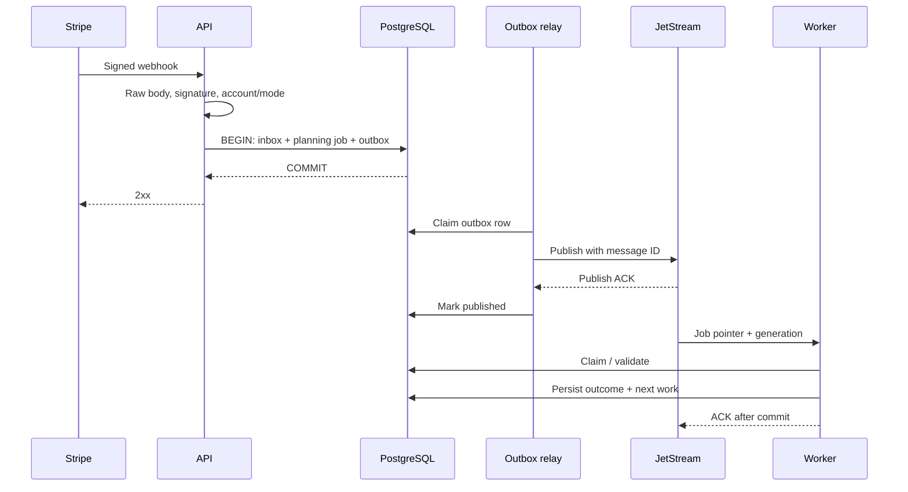

# RelayDesk: протокол надёжности

Статус: реализованный локальный контракт надёжности для durable recovery, Redis-квот, OAuth lifecycle, операторского интерфейса, reconciliation, retention, метрик и безопасного restore drill. Ограниченные проверки в test accounts не доказывают production-эксплуатацию; частные операционные записи не входят в публичный snapshot.

### Реализованные границы

- Подписанный Stripe webhook фиксирует inbox, revision, planning job и outbox одной PostgreSQL-транзакцией. JetStream доставляет указатель планировщику. Бизнес-действия сохраняются в PostgreSQL; их due scheduler не публикует отдельный JetStream message для каждого outbound вызова.
- Для `subscription_billing_sync.v1` создаётся CRM-действие, а у `invoice.paid` — зависимое Slack-действие. Каждый HTTP-вызов получает запись `business_provider_calls` до отправки; business attempt содержит стабильный effect key, generation, fencing token и для записи `request_started_at`.
- Состояния действия: `pending → running → succeeded`, `running → retry_wait → running`, `running → paused/blocked_auth/blocked_config/needs_attention/dead/unknown`. В схеме есть `queued`, но текущий DB scheduler его не использует. Пауза останавливает выбор новых действий и проверяется перед записью; уже переданный провайдеру запрос нельзя отозвать.
- CRM aggregate lease сериализует обычные записи по tenant, Stripe account/mode и customer. По истечении lease новая попытка перечитывает Stripe и HubSpot; совпадающее managed state завершает её без новой записи. Поздний HTTP-ответ старого worker нельзя отменить, поэтому это не строгая внешняя exactly-once гарантия.
- Slack-действие после сохранённого `request_started_at` и потери подтверждения переходит в `unknown`; автоматического replay нет. Успех требует `ok`, `channel` и `ts`.
- Реализованы `429` с `Retry-After`, ограничение business attempts, blocked/attention states, Redis limiter, операторский retry, OAuth refresh, test-mode provider execution и периодический business reconciliation. Production rollout остаётся отдельным этапом.

## 1. Инварианты

1. Для поддерживаемого валидного webhook `2xx` означает, что событие и обязанность его обработать сохранены одной транзакцией PostgreSQL. Недоступность БД не приводит к ложному успешному ответу.
2. Повторная доставка того же event ID не создаёт новый run или внешний эффект.
3. У каждой попытки внешнего действия есть предварительно сохранённая запись и стабильный effect key.
4. Успех шага фиксируется только после достаточного подтверждения результата. HTTP timeout не равен доказанному отказу внешней операции.
5. Повтор Slack-шага не повторяет успешный CRM-шаг. Retry продолжает действие с прежним effect key.
6. Задание не может использовать connection другого tenant. Защита есть в авторизации, SQL и constraints.
7. Запоздавшее событие не используется как команда записать устаревший Stripe snapshot. CRM пересчитывается из актуального источника и сходится с ним после завершения гонок.
8. Каждая незавершённая работа либо имеет активную lease, либо due time/dispatch, либо объяснённое blocked/unknown/dead состояние. «Пропавших между компонентами» задач быть не должно.
9. Очередь, Redis cache и process memory не являются единственным местом хранения подтверждения внешнего эффекта.
10. Автоматизация не продолжает вызовы с отозванным подключением после обнаружения отзыва; уже отправленный HTTP request может завершиться и должен быть учтён.

Гарантии действуют при сохранности PostgreSQL и ключей шифрования, соблюдении retention, корректной работе провайдеров в пределах их контрактов и достаточных квотах. Потеря основного хранилища разбирается отдельно через RPO/backup recovery.

## 2. Что означает «без дублирования»

| Уровень | Механизм | Предел гарантии |
| --- | --- | --- |
| Повтор webhook | Persistent unique event key | До удаления ключа по retention |
| Повтор JetStream | Проверка action/generation/status в БД | JetStream dedup — оптимизация, не основа |
| Повтор CRM projection | Stable external key, read/compare, deterministic upsert | Повтор HTTP-запроса возможен; внешние HubSpot workflows требуют отдельной проверки |
| Повтор invoice notification | Unique invoice/destination effect + confirmed Slack ts | Неизвестный результат отправки нельзя объявить несуществующим |
| Разные события об одном invoice | Business effect key по invoice | Дедупликация по event ID этого сама не решает |

JetStream поддерживает повторную доставку и собственные механизмы дедупликации/подтверждения. Они не образуют общую транзакцию с PostgreSQL и HTTP API. [NATS JetStream](https://docs.nats.io/concepts/jetstream), [NATS delivery semantics](https://github.com/nats-io/nats.docs/blob/master/using-nats/jetstream/model_deep_dive.md).

Для уведомления ключ, например: `tenant / stripe-account / test / invoice-id / invoice-paid / slack-workspace / channel`. В нём нет attempt ID. Для CRM используется customer aggregate и generation актуальной проекции; одинаковый projection hash не требует новой записи.

Нельзя глобально подавлять все `subscription.updated` по `(object_id, event_type)`: этим будут потеряны последующие реальные изменения. Event dedup и semantic effect dedup — разные механизмы.

## 3. Приём webhook и граница транзакции



Порядок:

1. Ограничить body и время чтения; получить неизменённые bytes.
2. По opaque connection ref найти допустимый signing secret. Проверить подпись официальным helper, timestamp tolerance и expected environment. Ротация secret допускает ограниченный период dual verification.
3. Проверить provider account binding. Для обычного account webhook account определяется проверенным endpoint/secret binding; для Connect-подобного формата дополнительно сверяется подписанный account context.
4. В короткой транзакции вставить inbox, идентификатор активной automation revision на момент приёма, durable planning job и outbox pointer. При unique conflict проверить существующую запись и вернуть успех без новой работы. Если automation ещё не активна, сохранить это решение: более поздняя повторная доставка не должна незаметно включить обработку старого события.
5. Неподдерживаемый, но корректный тип записать как `ignored` с причиной; malformed/invalid signature отклонить. Планировщик не должен постоянно падать на неизвестном типе события.
6. Ответить после commit. Никаких Stripe reads, HubSpot calls или Slack calls в webhook handler.

Stripe требует raw body для проверки подписи, допускает повторные доставки и не гарантирует порядок; sandbox retry schedule отличается от live. Не закладывать ожидание «Stripe всегда повторит ровно через минуту». [Stripe webhooks](https://docs.stripe.com/webhooks).

## 4. Inbox, jobs, outbox и доставка

Сообщение JetStream содержит только schema version, job/action ID, tenant ID, dispatch generation, correlation ID и trace link. Токены и raw payload не публикуются.

Outbox relay использует короткий claim через `FOR UPDATE SKIP LOCKED` и publish lease. HTTP/сетевой publish не выполняется внутри долгой SQL-транзакции. После JetStream publish ACK строка помечается опубликованной. При падении между ACK и записью в PostgreSQL возможна повторная публикация; `Nats-Msg-Id = outbox_id` уменьшает повторы в пределах dedup window, а DB generation/status делает их безопасными вне окна.

Каждая новая доставка после запланированного retry получает новый outbox ID и dispatch generation. Иначе broker dedup может подавить нужную повторную попытку.

Настройки транспорта:

- File-backed stream `relaydesk.work.v1`, subjects по типу работы/provider; небольшой фиксированный набор durable pull consumers.
- `AckExplicit`, bounded fetch batch и `MaxAckPending`, согласованные с worker pool.
- WorkQueue retention для исполнения; история остаётся в PostgreSQL. Consumers имеют непересекающиеся фильтры.
- Stream size/message size/age лимитированы; при заполнении предпочтительно отклонять новые публикации (`DiscardNew`), сохраняя outbox и создавая alert, а не тихо выталкивать ожидающую работу.
- Ack timeout должен покрывать ограниченный HTTP deadline и сохранение результата; при длинной обработке — progress heartbeat. PostgreSQL lease проверяется независимо.
- Broker redelivery решает транспортные сбои. Business backoff рассчитывает только scheduler в PostgreSQL.
- Для transport допускается unlimited redelivery с мониторингом delivery count; после устойчивого poison failure job транзакционно переводится в quarantine/DLQ. Если позднее вводится конечный `MaxDeliver`, обязателен recovery/advisory handler: лимит доставки сам по себе не является бизнес-DLQ.

JetStream при достижении MaxDeliver не реализует требуемый продуктовый процесс исправления ошибки автоматически; приложение должно связать transport failure с persisted job. [NATS consumer configuration](https://github.com/nats-io/nats.docs/blob/master/nats-concepts/jetstream/consumers.md).

Watchdog ищет runnable jobs без активной lease и без прогресса, учитывает живую dispatch lease и после timeout атомарно создаёт следующую generation/outbox. Это восстанавливает работу после удаления/истечения broker message или восстановления NATS с неполным состоянием. Дубликаты указателей допустимы; дубликаты бизнес-эффектов решаются в executor.

## 5. Планирование и жизненный цикл

Planning job проверяет eligibility события, зафиксированную в inbox automation revision и customer aggregate. Если конфигурация выключена или событие предшествует первой activation и не является явным backfill — `ignored`/`paused` с объяснением. Версия выбирается при первом durable acceptance, а не по очередности обработки или сортировке event IDs. Pause — отдельный execution gate: уже принятая работа сохраняет revision, но ждёт разрешения внешних действий.

Создаются run и два зависимых действия: CRM projection, затем Slack notification для поддерживаемого invoice fact. Subscription-only события могут иметь только CRM action. Run и action definitions immutable; меняется только состояние исполнения. Исправление mappings/config создаёт отдельную repair revision с audit и preview, не переписывает прошлые attempts и не сбрасывает effect keys.

Базовая state machine action:

```text
pending → queued → running → succeeded
                     ├──→ retry_wait → queued
                     ├──→ blocked_auth / blocked_config / paused
                     ├──→ unknown → verified_success / safe_retry / needs_attention
                     └──→ dead

pending/queued → canceled или superseded (только если эффект ещё не отправлен)
```

`unknown`, blocked и dead — разные состояния. Unknown означает отсутствие знания о внешнем результате; dead означает остановку по постоянной ошибке/исчерпанию retry policy. DLQ в панели показывает dead, отдельный фильтр — unknown и blocked.

Run status вычисляется из действий: queued/running/waiting/needs_attention/succeeded/partial_failed/canceled. Если CRM готова, но Slack не готов, показывать partial progress; это не полный успех.

### Claims и leases

- Claim атомарно переводит нужную generation из runnable в running, записывает owner, expiry и monotonic fencing token.
- Устаревший worker не может записать success поверх нового состояния: compare-and-swap по fencing token.
- Lease превышает HTTP timeout и обновляется heartbeat; DB-транзакция не держится на протяжении вызова провайдера.
- Истечение lease означает необходимость recovery, а не автоматическое доказательство того, что вызова не было.
- Если attempt помечен `request_started` и не имеет результата, recovery для неидемпотентного действия переводит его в unknown.

Локальный fencing не останавливает уже отправленный внешний HTTP request. HubSpot/Slack не обязаны принимать наш fencing token. Поэтому нельзя обещать строго линейное выполнение внешних записей только за счёт SQL lease.

## 6. Выполнение шага и точка ACK

1. Worker валидирует envelope, tenant, generation, dependency и connection generation.
2. Если действие уже завершено — ACK без provider call. Если ещё не due — проверить наличие durable schedule, затем ACK текущий pointer.
3. Получить lease и provider quota. Если квоты нет, сохранить due_at, освободить claim и ACK; не спать в goroutine до завтра.
4. Проверить/обновить credential. При revoke/block сохранить состояние, ACK.
5. Зафиксировать attempt и `request_started` до outbound call.
6. Выполнить ограниченный по времени вызов. Provider adapter классифицирует результат: confirmed success, safe retryable, permanent, auth, ambiguous.
7. Одной транзакцией сохранить attempt outcome, состояние action, external reference и dependent action/outbox, если есть.
8. ACK сообщения только после commit. При ошибке commit сообщение остаётся неподтверждённым; recovery учитывает возможный внешний эффект.

Для transient failure эта транзакция сохраняет `retry_wait` и next_attempt_at; сообщение ACK-ается, поскольку обязанность повторить уже долговечна в БД. Scheduler позже создаёт dispatch/outbox. Нельзя одновременно оставлять тот же business retry на NATS delayed NAK и в DB scheduler.

## 7. Актуальность и порядок событий

Webhook считается сигналом перечитать состояние, а не приказом применить старый snapshot. `event.created` не является надёжной полной версией объекта: разные события могут иметь одинаковую секунду. Event IDs используются для dedup, не для сортировки бизнес-версий. [Stripe ordering](https://docs.stripe.com/webhooks#event-ordering).

Ключ сериализации: `(tenant, stripe_account, mode, customer_id)`; несколько подписок одного клиента не пишут независимо в одну карточку.

Executor:

1. Берёт aggregate lease с generation.
2. Читает актуальные Customer, выбранную Subscription и релевантный Invoice из Stripe с pinned API contract.
3. Строит детерминированную проекцию; money — integer minor units + currency, timestamps — UTC.
4. Сравнивает desired hash с известным/прочитанным HubSpot managed state.
5. Если изменение не нужно — отмечает шаг как no-op success.
6. При изменении делает upsert/PATCH, сохраняет подтверждённый результат.
7. Если за время обработки aggregate стал dirty, планирует следующий reconcile. Перед повтором старой generation не отправляет сохранённый старый payload, а заново читает source.

Coalescing допустим для current-state CRM projection. Invoice notification facts не схлопываются вместе с ней: два оплаченных invoice — два разных факта, повтор одного invoice — один эффект.

Остаётся окно: старый запрос может завершиться с задержкой после нового запроса при потере lease/сетевом разделении. Без conditional write со стороны провайдера невозможно гарантировать отсутствие даже кратковременного отката. Контракт RelayDesk — сериализация в нормальном режиме, обнаружение неопределённости и eventual convergence через повторное чтение/сверку. Тесты должны показывать восстановление этого окна, а документация — не называть его строгим exactly-once.

## 8. Provider-specific эффекты

### HubSpot

Upsert создаёт/обновляет контакт по стабильному unique key; существующая явная mapping использует Contact ID. Hash включает только managed business fields. Не менять `synced_at` при no-op, чтобы каждый retry не становился новым изменением.

При timeout после записи: read by stable key/Contact ID и compare managed fields. Если желаемая актуальная проекция уже применена — подтвердить. Если нет — пересчитать из Stripe и выполнить безопасный state update. Конфликт email/unique property, archived/merged contact и отсутствующий schema property имеют отдельные коды; не лечить их повторным create.

Одинаковое состояние Contact не доказывает, что downstream HubSpot workflow не выполнился дважды. MVP гарантирует отсутствие новых дублей Contact и правильный итог managed state в проверенных сценариях, но не универсальную exactly-once семантику всех сторонних CRM automation.

### Slack

Выбран Web API bot flow, чтобы сохранять подтверждённые `channel`/`ts` и ссылку на сообщение. Успех определяется не только HTTP status, но и provider response (`ok` и reference).

После явного `429`/ошибки до отправки request можно безопасно запланировать retry. После timeout, обрыва после передачи запроса, определённых 5xx или падения worker до сохранения success — `unknown`. Slack описывает ошибки, при которых операция могла частично состояться. [Slack chat.postMessage](https://docs.slack.dev/reference/methods/chat.postMessage/).

В MVP unknown не отправляется автоматически заново. Оператор видит operation marker и проверяет канал; может подтвердить сообщение внешней ссылкой, оставить unresolved либо явно разрешить повтор с предупреждением о возможном дубле и audit reason. Подтверждённый existing `ts` можно использовать для точечного update в будущей версии.

`client_msg_id`/metadata могут помогать корреляции, но не считаются безусловной гарантией dedup без проверенного контракта именно выбранного метода. Автоматический поиск сообщения потребует дополнительных read scopes и квот; отсутствие результата поиска не доказывает отсутствия сообщения.

Таким образом, минутная недоступность HubSpot восстанавливается автоматически без повторного уведомления: Slack ещё не запускался до успешного CRM шага. Сценарий потери Slack-ответа имеет другую политику и показывается отдельно.

## 9. Классификация ошибок и retry policy

| Событие | Решение |
| --- | --- |
| Connect/DNS error до передачи request | Safe retry с jitter |
| Timeout после возможной передачи | Проверить идемпотентность; read/compare либо unknown |
| HubSpot retryable 5xx | State reconcile + повтор; учитывать возможную запись |
| Slack ambiguous 5xx | Unknown, не слепой повтор |
| 429 | Provider-scoped cooldown с Retry-After, без busy loop |
| 401 / expired credential | `blocked_auth`; OAuth refresh не реализован и не имитируется |
| 403 / missing scope | blocked_config/reconnect, без бесконечного refresh |
| 400 / mapping/schema error | needs_attention/dead по постоянному коду |
| 404 Contact | Проверка mapping/merge, затем blocked_config при невозможности исправления |
| 409 identity conflict | Mapping resolution, без create-loop |
| PostgreSQL недоступен | Не ACK; outbound не начинать без durable attempt |
| NATS недоступен | Inbox/outbox сохраняются, drain после восстановления |
| Redis недоступен | Fail closed для outbound, durable retry_wait |

Начальная политика transient calls: exponential backoff с full jitter, base 5 s, cap 15 min, до 12 provider attempts или 24 h от первой попытки — что наступит раньше. Лимиты конфигурируемы и проверяются относительно обещанного recovery time. `Retry-After` — нижняя граница ожидания; короткий random backoff не должен её обойти.

Ожидание квоты, пауза circuit breaker и blocked_auth не расходуют число HTTP attempts, но учитываются в общем возрасте/алертах. Для них есть отдельный maximum waiting age/операторское решение, чтобы вечное ожидание не выглядело здоровой работой.

Отдельный circuit breaker с half-open probes пока не реализован. PostgreSQL хранит `429` cooldown на connection и блокирует ранний scheduler/claim/write. При shutdown worker прекращает fetch, завершает bounded in-flight, сохраняет результаты; незавершённые leases восстанавливаются штатным recovery.

## 10. Redis rate limiting и справедливость

Redis Lua guard атомарно ограничивает outbound *write* по tenant/connection фиксированным окном (по умолчанию пять записей в секунду). Он fail-closed при недоступном Redis в production worker path. Он не заменяет более точные provider-specific квоты на чтение и запись. Для production требуется conservative sliding window/GCRA с явно проверенной burst policy и сопоставлением provider account/workspace/channel.

Scopes: HubSpot app + portal, Stripe account + endpoint category, Slack app + workspace + method, дополнительно channel для отправки сообщений. Provider account важнее условного tenant ID, если позднее разрешено shared подключение. Для нескольких budgets не допускать частичного списания или отрицательных токенов; MVP использует один Redis primary без Cluster и атомарный скрипт.

Лимиты — конфигурация по provider/app type, с запасом и учётом headers. HubSpot ограничения зависят от типа приложения и тарифа; Search API имеет отдельные правила. Slack возвращает `Retry-After` при rate limiting. Поэтому не зашивать одно число «запросов в секунду» для всех интеграций. [HubSpot limits](https://developers.hubspot.com/docs/developer-tooling/platform/usage-guidelines), [Slack limits](https://docs.slack.dev/apis/web-api/rate-limits/).

После потери Redis budgets нельзя сразу начинать с полного burst: conservative cold start/cooldown, затем плавное восстановление. При недоступности Redis outbound откладывается; ingress продолжает durable приём до квот хранилища.

Scheduler выдаёт небольшую порцию due jobs на tenant и общий ограниченный batch, поддерживает per-tenant in-flight limit и separate provider pools. Один клиент с тысячами retries не должен занять все executor slots. Raw FIFO из общей очереди без fair admission недостаточен. Backlog quota и age видны владельцу; при исчерпании ingress budget неподтверждённое событие получает retryable отказ и фиксируемую операторскую проблему, а не silent drop.

## 11. DLQ, ручной повтор и сверка

Canonical DLQ — PostgreSQL actions со статусом `dead`, сохранённой причиной, attempts и config revision. Дополнительный JetStream DLQ stream содержит pointers для операций/alerting и наполняется через outbox; его потеря не уничтожает список ошибок.

Retry:

- Доступен operator/owner, tenant-scoped, записывает actor и reason.
- Блокируется для running action и confirmed success.
- Для unknown требует отдельного resolve flow, обычная Retry-кнопка недоступна.
- Создаёт новую execution attempt/generation того же effect, не новый независимый effect.

### Реализованный протокол действий

`internal/business/action_state.go` задаёт допустимые переходы. Продукционный worker выполняет `pending/retry_wait → queued` через `queue_business_actions()`, записывая `business_action_outbox` и новый `dispatch_generation` одной транзакцией. `claim_business_action_pointer()` проверяет tenant, generation, dependency, pause, connection и cooldown под блокировкой строки, затем создаёт `running` claim, monotonically increasing fencing generation и attempt до HTTP. PostgreSQL `now()` — источник времени для due, lease и cooldown. Исполнитель продлевает 30-секундный action/aggregate lease каждые 8 секунд; каждый heartbeat и result commit проверяет token и generation. Весь HTTP ограничен 20-секундным контекстом и 5-секундным client timeout.

`finish()` одной транзакцией записывает состояние, outcome, safe class, retry due, provider reference и обновлённый run status. Полный jitter использует 5 секунд base, 15 минут cap, 12 записанных provider HTTP calls или 24 часа от первой попытки. Тесты могут внедрить другой random/policy. `Retry-After` задаёт нижнюю границу; connection cooldown сохраняется отдельно. Пауза и Redis guard не тратят HTTP-call budget. При ошибке PostgreSQL commit указатель не ACK-ается. При успешной записи `retry_wait` ACK-ается текущий указатель, а очередная generation создаётся только PostgreSQL scheduler. NATS не управляет business delay.

Раз в 30 секунд `repair_business_actions()` проверяет истёкшие action leases и queued actions старше 45 секунд. Для уже начатого Slack write без результата он сохраняет `unknown`; CRM возвращает к чтению актуального Stripe/HubSpot. Старые pointer/outbox generation помечаются superseded, затем создаётся новая outbox запись. Planning outbox repair работает отдельно по существующему протоколу. Dead-letter список — строки `business_actions.status='dead'`; отдельной скрытой broker DLQ нет.

`decide_business_action()` требует действующую owner/operator session, expected generation, reason и optional idempotency key. Обычный retry доступен только для `dead`, `needs_attention`, `blocked_auth`, `blocked_config`. `unknown` требует `confirm_unknown` с исходным каналом и Slack timestamp, `leave_unknown` или `risk_retry` с явным подтверждением возможного дубля. Подтверждение оператором остаётся помеченным `confirmation_source='operator'`; это не provider read verification. Решения и попытки доступны авторизованным tenant members в истории.

Тестовый legacy DB poller ещё существует, но основной worker использует action pointers. Provider quotas, tenant fairness и периодическая сверка известных Stripe customers включены в текущую реализацию. При очень поздней внешней HubSpot записи после потери lease возможен временный откат managed fields: локальный fencing не передаётся в HubSpot. Периодическая сверка обеспечивает eventual convergence при доступных Stripe/HubSpot, но не строгую внешнюю сериализацию.
- Проверяет актуальность connection/account и наличие credentials.
- CRM replay пересчитывает current state; исторический payload не откатывает CRM.
- Повтор большого набора требует limit и pacing; повтор задачи не обходит API quotas.

Reconciliation двух типов:

1. **Execution repair** каждые ~30 s: outbox leases, зависшие planning/actions, потерянные dispatch, просроченные lease. Никаких внешних side effects без обычного executor.
2. **Business reconciliation**: периодическая ограниченная сверка известных customers/subscriptions и недавних Stripe events с overlapping window; durable checkpoint продвигается только после сохранения очередной страницы. Она обнаруживает missing webhook и drift managed fields.

События за недоступным provider history/retention не считаются восстановленными автоматически. Stripe Events discovery использует документированные `created`, `types[]`, `limit` и `starting_after`, не `updated_since`; его история ограничена 30 днями. Если перерыв превысил окно, checkpoint сохраняет coverage gap; bounded current-state scan известных customers чинит проекцию, но не восстанавливает неизвестные invoice facts. Право Events Read и фактическое продвижение checkpoint проверяются отдельно для каждого подключения.

Все найденные расхождения идут через те же actions/effect keys, quotas и audit. Reconciler не должен становиться тайным вторым implementation business logic.

Dedup и effect identities сейчас сохраняются без автоматического удаления. Подписанный `invoice.paid` старше поддерживаемого 90-дневного окна принимается с источником `historical` и не создаёт Slack-действие; текущая CRM проекция читается отдельно, если событие допустимо для планирования. Нельзя удалять tombstones и одновременно обещать безопасный произвольный replay событий любой давности.

## 12. Матрица точек отказа

| Точка отказа | Ожидаемый результат |
| --- | --- |
| До commit inbox | Нет 2xx; событие может быть доставлено заново |
| После commit, до HTTP 2xx | Повтор Stripe найдёт existing event |
| После DB commit, до NATS publish | Outbox relay доставит позже |
| После publish ACK, до mark published | Возможен duplicate pointer, эффект не повторяется |
| После claim, до provider request | Lease recovery вернёт работу в очередь |
| После provider success, до local success commit | HubSpot read/compare; Slack unknown |
| После success commit, до ACK | Redelivery увидит success и только ACK |
| Во время credential refresh | Version check; lost rotation result может потребовать reconnect |
| Во время ручного Retry с двух вкладок | Один CAS transition и одна новая generation |
| Во время DB restore | Остановка outbound, восстановление ключей, проверка возможных внешних эффектов, reconciliation до resume |

Последняя строка существенна: восстановленная БД может забыть уже отправленное сообщение. Нельзя после restore автоматически replay всего от backup checkpoint. Для потенциально отправленных notification actions вводится quarantine/unknown; state projections восстанавливаются сверкой.
